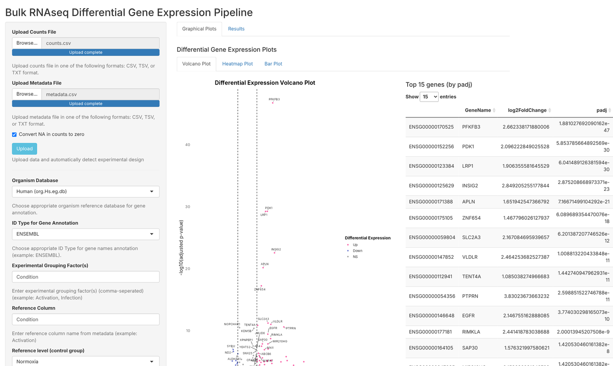
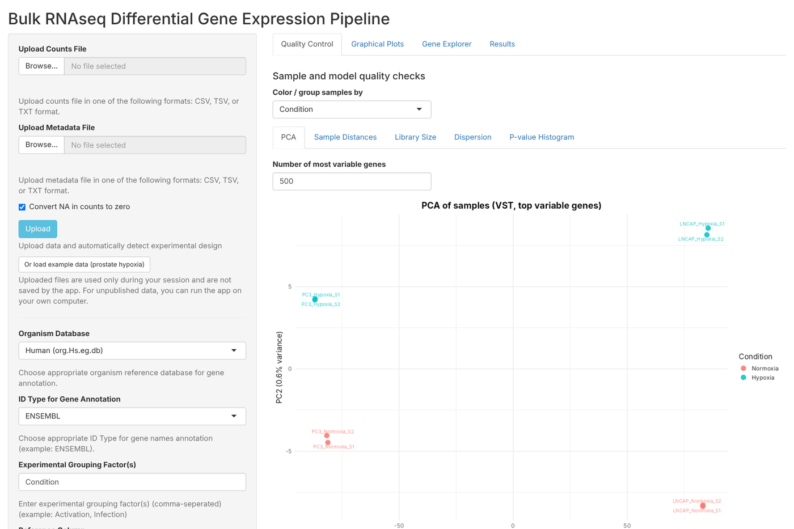

# Bulk RNA-seq Differential Expression Shiny App

An interactive **R Shiny** app that runs a complete bulk RNA-seq differential expression analysis with **DESeq2**, from a raw count matrix to annotated results and publication-ready plots, **without writing any code**.

This is the web-ready version of the app, built to run online so anyone can use it from a browser without installing R. The original version is at [rnaseq-shiny-app](https://github.com/lizetafo/rnaseq-shiny-app).

Upload a count matrix and a sample sheet, check the experimental design the app detects, and click **Run**. The app runs DESeq2, adds gene names, and produces volcano plots, heatmaps, bar plots and result tables you can download.

### ▶️ [Try the app online](https://01a1c6c1-cbf8-a124-ddcd-1f24a83e1a02.share.connect.posit.cloud/)
No installation needed. Click **Or load example data** to explore it with a public dataset. The app may take up to a minute to wake up if nobody has used it recently.



---

## ✨ Features
- **Flexible input:** count matrices and sample sheets as CSV, TSV or TXT, up to 1 GB
- **Built-in checks:** missing or mismatched samples, sample order, duplicated samples and gene IDs, missing counts
- **Guided design setup:** detects the grouping factor and design formula, asks you to choose the control group, then fills in the contrast, all editable
- **Multi-factor designs**, for example `~CellLine + Condition`
- **Gene annotation** for human, mouse, rat, fly, zebrafish and yeast, or any other Bioconductor organism package, from Ensembl, Entrez or symbol IDs. Each organism database is downloaded only the first time it is used.
- **Quality control:** PCA, sample-to-sample distance heatmap, library sizes, dispersion plot and p-value histogram
- **Result plots:** volcano plot with labeled top genes, MA plot, clustered heatmap (normalized, VST or rlog) and bar plot
- **Gene Explorer:** pick any gene to see its counts per group and its statistics
- **Example data built in:** one click loads a public dataset to try the app
- **Every plot downloadable** as PNG
- **Tables:** annotated results, raw DESeq2 results and normalized counts, all downloadable
- **Validated:** results are identical to running DESeq2 directly ([validation](validation/VALIDATION.md))

## 🚀 Quick start
1. Install the packages once, in RStudio with this folder as the working directory:
   ```r
   source("setup/install_packages.R")
   ```
2. **Session → Restart R**, open `app.R`, and click **Run App**.
3. Click **Or load example data (prostate hypoxia)**, or upload your own counts and metadata files and click **Upload**.
4. Choose **Normoxia** as the **reference level (control group)**. The contrast fills in as `Condition, Hypoxia, Normoxia`. Click **Run**.

Step-by-step instructions with screenshots: **[docs/user_guide.md](docs/user_guide.md)**

## 🔬 Quality control and gene explorer


## 🌐 Online version
The app can be hosted free on Posit Connect Cloud, so anyone can use it from a link: see [docs/deploy_connect_cloud.md](docs/deploy_connect_cloud.md).

## 🧪 Example datasets
| Dataset | Organism | Comparison |
|---|---|---|
| `prostate_hypoxia` | Human | Prostate cancer cell lines, hypoxia vs normoxia |
| `tumor_vs_normal` | Human | Colorectal tumor vs normal colon (37 samples) |

Both datasets are public GEO data, from Guo et al., *Nature Communications* 2019 and Kim et al., *Molecular Oncology* 2014 ([GSE106305](https://www.ncbi.nlm.nih.gov/geo/query/acc.cgi?acc=GSE106305) and [GSE50760](https://www.ncbi.nlm.nih.gov/geo/query/acc.cgi?acc=GSE50760)). Sources, settings for each dataset and the required file format: [example_data/README.md](example_data/README.md)

## ✅ Validation
For both datasets, the app's results were compared with DESeq2 run directly. Every gene, fold change, p-value and normalized count was **identical**, with the same significant genes (302 and 6,834; 4,895 with a two-factor design). Details: [validation/VALIDATION.md](validation/VALIDATION.md).

## 📁 Repository structure
```
├── app.R                         # the Shiny app
├── manifest.json                 # package list for online hosting (created by setup/make_manifest.R)
├── setup/
│   ├── install_packages.R        # one-time package installation
│   └── make_manifest.R           # creates manifest.json for Posit Connect Cloud
├── docs/
│   ├── user_guide.md             # step-by-step instructions
│   ├── outputs.md                # what each table column and plot means
│   ├── methods.md                # analysis steps and where the app fits in an RNA-seq workflow
│   ├── deploy_connect_cloud.md   # how to put the app online
│   └── screenshots/
├── example_data/                 # 2 example datasets (counts + metadata)
└── validation/
    ├── VALIDATION.md
    └── compare_to_deseq2.R       # re-runs the comparison
```

## 🛠️ Built with
R · Shiny · DESeq2 · AnnotationDbi · ComplexHeatmap · ggplot2 · ggrepel · dplyr · DT

## 👩🏾‍🔬 Author
**Elizabeth Etafo**, Ph.D. candidate, Pharmaceutical Sciences, University of Nebraska Medical Center
[elizabethetafo.com](https://elizabethetafo.com) · [LinkedIn](https://www.linkedin.com/in/eetafo/)
