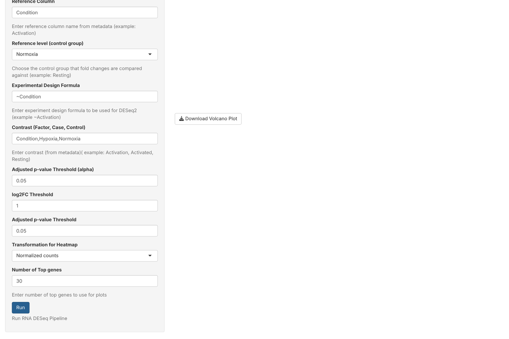
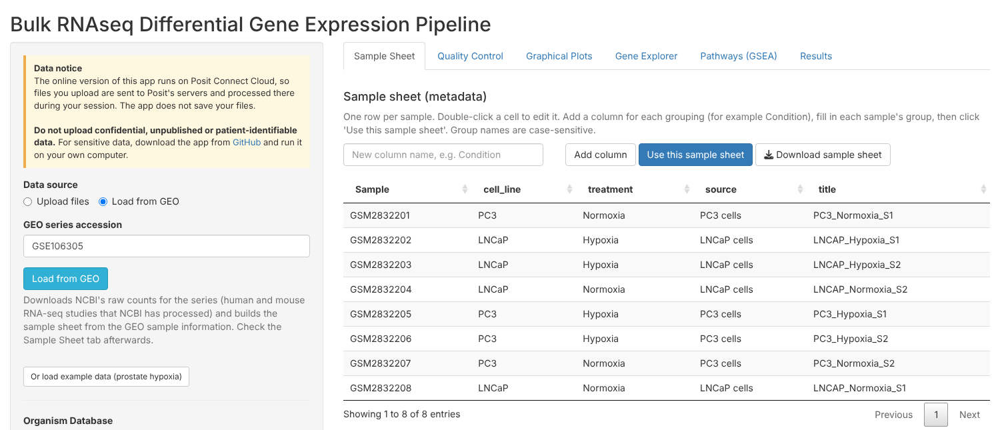
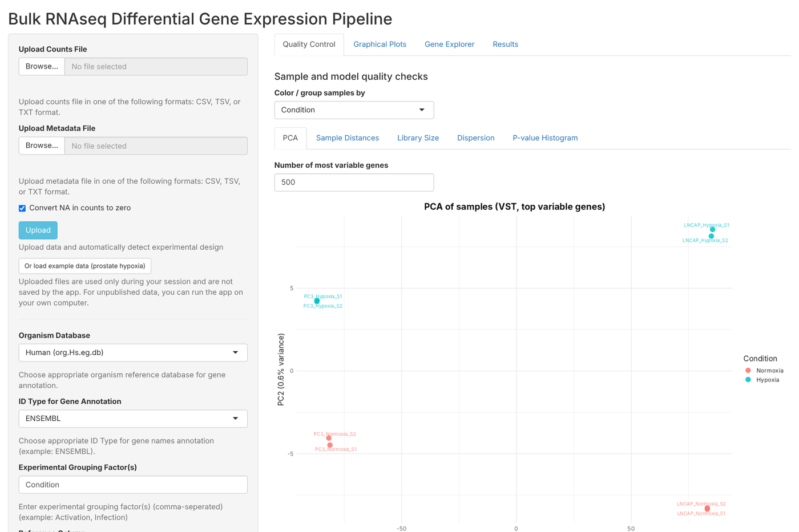
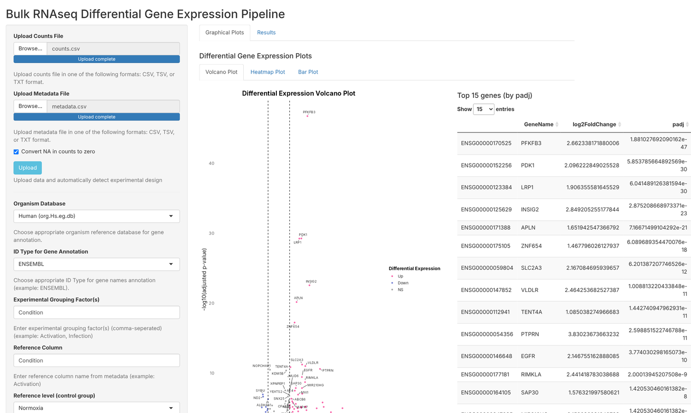
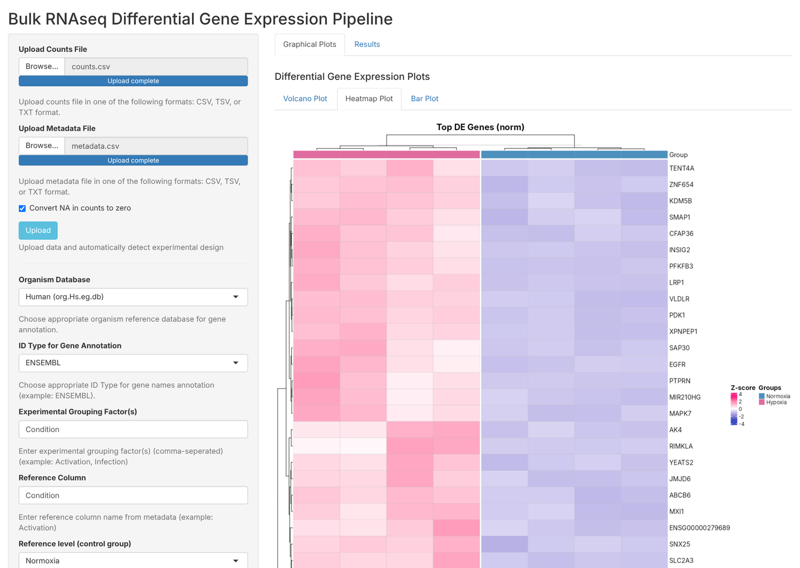
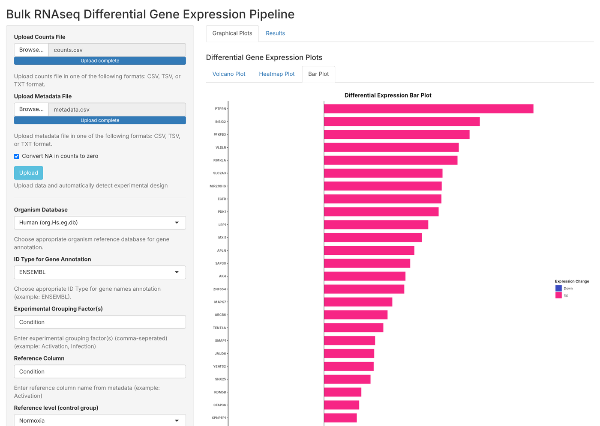
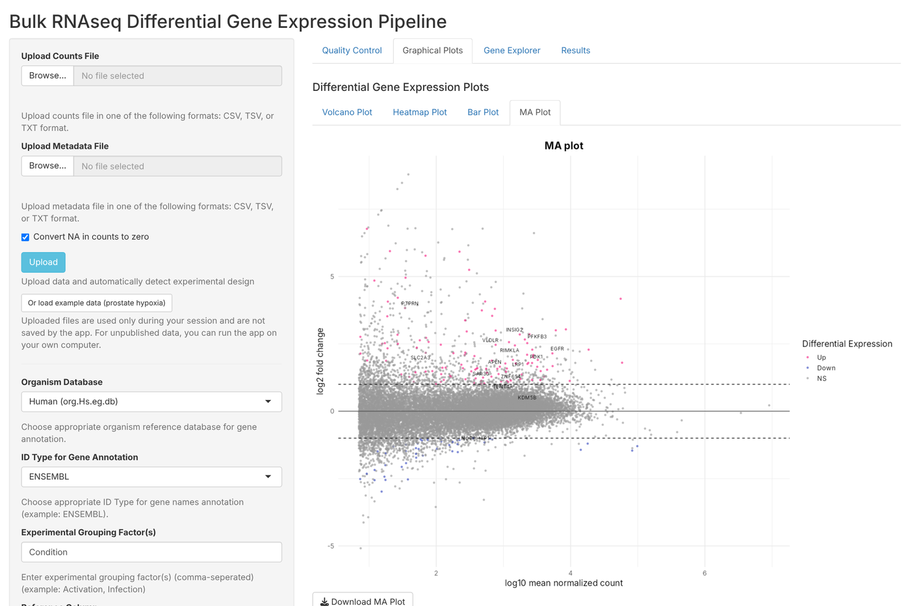
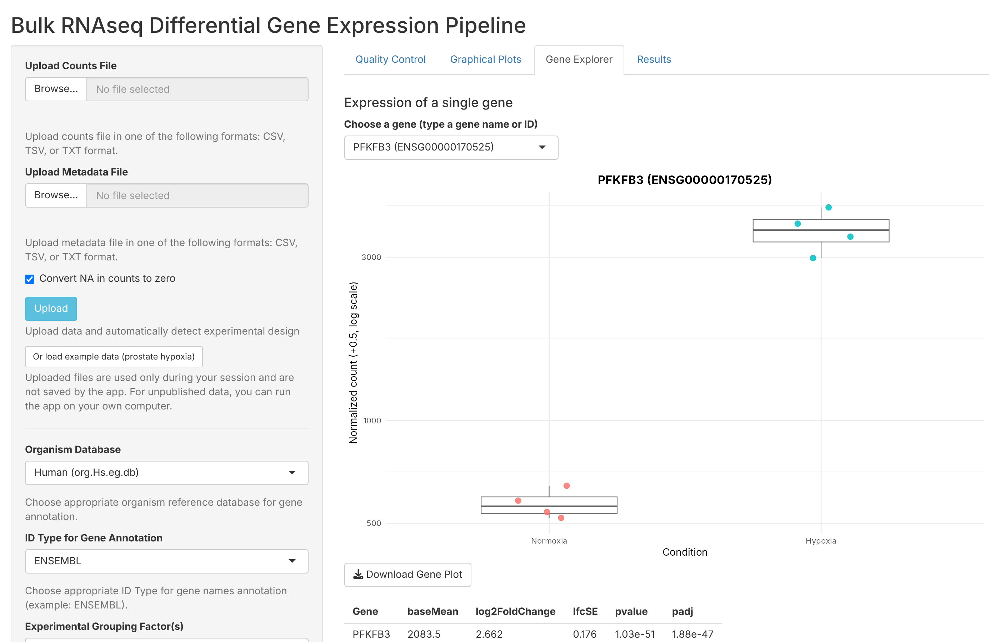
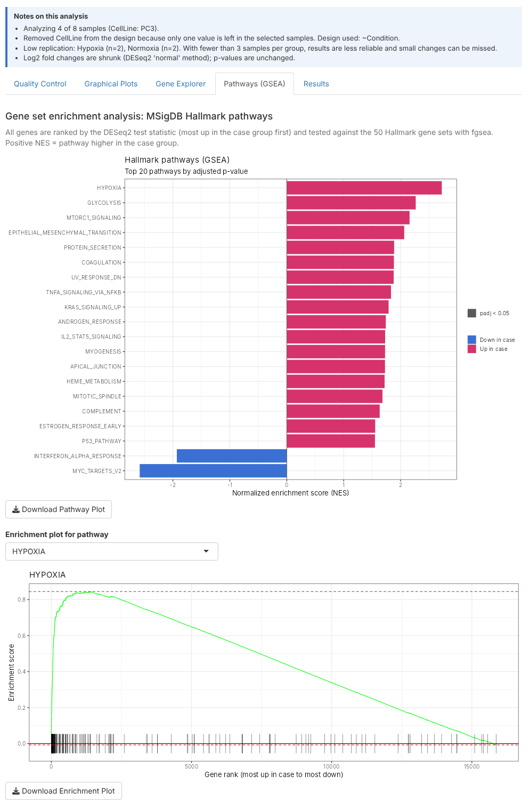
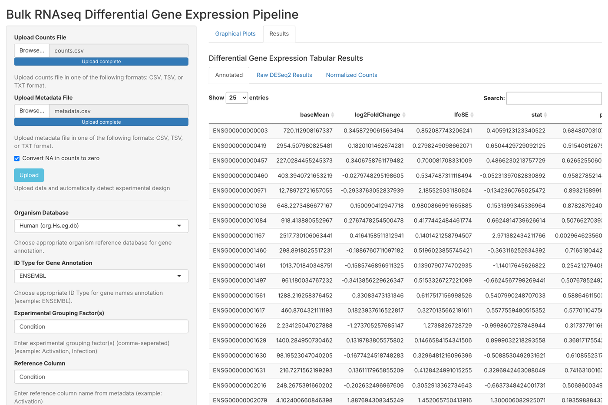

# User guide

## 1. One-time setup
Open RStudio, set the working directory to this repository folder, and run:
```r
source("setup/install_packages.R")
```
Then go to **Session → Restart R**.

> Organism databases are large downloads. The setup script installs the **human** database. Others (mouse, rat, fly, zebrafish, yeast) are installed automatically the first time you select them in the app, which can take a few minutes once.

## 2. Start the app
Open `app.R` in RStudio and click **Run App**.

---

## 3. Upload your data and settings



There are three ways to get data in. Choose **Data source** at the top of the sidebar:

**A. Load from GEO.** Choose **Load from GEO**, type a series number such as `GSE106305`, and click **Load from GEO**. The app downloads NCBI's raw counts for that study and builds the sample sheet from the study's sample information (for example cell line and treatment). The organism and ID type (Entrez) are set for you. The app first uses NCBI's raw counts, which exist for many human and mouse studies (the **"Download RNA-seq counts"** button on the GEO page). NCBI uses one standard pipeline, so counts can differ slightly from the original paper. If NCBI has none, for example for very new studies, the app uses the **authors' own count file** from the study's supplementary files (text or Excel). It then matches the file's sample columns to the GEO samples by name. Check the **Organism** and **ID Type** afterwards. If the authors only uploaded normalized values (FPKM, TPM), the app says so, because DESeq2 needs raw counts.

**B. Upload files.**
1. **Upload Counts File(s)**, any of:
   - one count table (genes × samples)
   - a featureCounts output (the Chr/Start/End/Strand/Length columns are removed automatically)
   - several per-sample count files from HTSeq or STAR (select them all at once; they are merged)
   - a GEO `_RAW.tar` bundle of per-sample count files

   CSV, TSV, TXT and `.gz` are accepted. See [input format](../example_data/README.md#input-format).
2. **Upload Metadata File (optional)**: one row per sample. If you don't have one, leave it empty and fill in the sample sheet in the app (below).
3. Leave **Convert NA in counts to zero** ticked unless you want the app to stop on missing values. Tick **Round estimated counts** only for RSEM or Salmon estimated counts.
4. Click **Upload**.

**C. Example data.** Click **Or load example data (prostate hypoxia)**.

The app checks the data before going further:
- **Normalized data is refused.** If values are not whole numbers (FPKM, RPKM, TPM, CPM) or are negative (log values), the app stops and explains why. DESeq2 needs raw counts.
- Sample names must match between counts and metadata. Metadata in a different order is reordered automatically.
- Stray spaces in group labels are removed.

It then detects the grouping column (the first column with 2–10 groups and replicates) and fills in the settings below.

**Sample Sheet tab.** This tab shows the sample information, and you can edit it:
- **Double-click a cell** to change it.
- **Add column** creates a new grouping column (for example `Condition`) to fill in.
- **Use this sample sheet** applies your changes and re-detects the design.
- **Download sample sheet** saves it as CSV for next time.

If no usable grouping is found (for example when you upload counts only), the app opens this tab and asks you to fill it in.



5. **Choose the control group** in **Reference level (control group)**. The app does not guess it. The **contrast** then fills in automatically (case first, control last). Check the other settings:

| Setting | What it means | Example |
|---|---|---|
| **Organism Database** | Used to add gene names | Human (org.Hs.eg.db) |
| **ID Type** | The type of gene IDs in your counts file: `ENSG…` = ENSEMBL, numbers = ENTREZID, gene names = SYMBOL | ENSEMBL |
| **Experimental Grouping Factor(s)** | Metadata column(s) that define groups; separate several with commas | `Condition` |
| **Reference Column / Reference level (control group)** | The **control** group that fold changes are measured against. Choose it from the dropdown. | `Condition` / `Normoxia` |
| **Experimental Design Formula** | DESeq2 design; add covariates with `+` | `~Condition` or `~Activation + Infection` |
| **Contrast (Factor, Case, Control)** | The comparison to report: **case first, control last** | `Condition, Hypoxia, Normoxia` |

With contrast `Condition, Hypoxia, Normoxia`, a **positive log2 fold change means higher in Hypoxia**.

**Thresholds**
- **Adjusted p-value threshold (alpha)**: significance cut-off used by DESeq2 (default 0.05).
- **log2FC threshold** and **adjusted p-value threshold** for the plots: which genes are colored as significant on the volcano plot.
- **Transformation for heatmap**: normalized counts, VST or rlog. VST and rlog stabilize the variance of low counts, and VST is a good default.
- **Number of top genes**: how many genes to label and show in the heatmap and bar plot.
- **Shrink log2 fold changes** (optional): makes fold changes of low-count genes more reliable, so noisy genes don't top the bar plot. P-values do not change. It is not available for designs with interaction terms.

**Analyze a subset of samples (optional).** Choose a metadata column, for example `CellLine`, then keep only the values you want, for example `PC3`. Design factors with a single value left are removed from the design automatically, and the app tells you.

6. Click **Run**. If no control group is chosen, the app asks for one. DESeq2 usually takes from a few seconds to about a minute.

A blue **Notes on this analysis** box above the tabs lists anything important about the run: the subset used, factors removed from the design, groups with fewer than 3 replicates, and whether fold changes were shrunk.

**Result to show (advanced).** After a run, this list shows every DESeq2 coefficient. Pick one, such as an interaction term, to see its results without re-running. Example: design `~CellLine + Condition + CellLine:Condition` and result `CellLinePC3.ConditionHypoxia` shows genes whose hypoxia response differs between PC3 and LNCaP.

> **Privacy:** the online version runs on Posit Connect Cloud, so uploaded files are processed on Posit's servers during your session. The app does not save them. Do not upload confidential, unpublished or patient-identifiable data online; run the app on your own computer instead.

---

## 4. Quality control (check this first)

The **Quality Control** tab shows whether the samples and the model look healthy **before** you interpret results. Use **Color / group samples by** to color samples by any metadata column.



| Plot | What to look for |
|---|---|
| **PCA** | Replicates of the same group should cluster together. If samples separate mainly by something else (cell line, batch, donor), add that column to the design, for example `~CellLine + Condition`. |
| **Sample Distances** | Darker squares = more similar samples. Samples should group by condition. A sample unlike all others may be an outlier. |
| **Library Size** | Total reads per sample and the DESeq2 size factor (SF). Big differences are normal, because DESeq2 corrects for them, but a sample with very few reads deserves a second look. |
| **Dispersion** | DESeq2's variability estimates. Blue (final) points should follow the red trend line. |
| **P-value Histogram** | Ideally flat with a peak near 0. A histogram rising toward 1 suggests a source of variation missing from the design. |

**Example:** in the prostate dataset, the PCA shows that **cell line** (LNCaP vs PC3) explains 98.6% of the variation. With `~Condition`, 302 genes are significant. With the design `~CellLine + Condition` (Experimental Grouping Factor(s): `Condition, CellLine`), 4,895 genes are significant, because the cell line difference no longer hides the hypoxia effect.

---

## 5. Result plots

**Volcano plot:** every gene, log2 fold change vs. significance, with the top genes labeled. A table of the top 15 genes appears beside it.



**Heatmap:** the top genes across all samples, scaled per gene (z-score) and clustered.



**Bar plot:** the most significant genes (lowest adjusted p-value) shown as bars of their log2 fold change, colored up (pink) or down (blue).



**MA plot:** fold change against average expression for every gene. Genes with low counts tend to show larger, less reliable fold changes.



Each plot has a **Download** button.

## 6. Gene Explorer

Pick any gene, by typing its name or ID, to see its normalized counts in each group and its DESeq2 statistics. The most significant gene is shown first.



## 7. Pathway analysis (GSEA)

The **Pathways (GSEA)** tab ranks every gene by its DESeq2 test statistic and tests the 50 MSigDB Hallmark pathways with fgsea.
- **Bar plot:** normalized enrichment score (NES) of the top pathways. Positive = higher in the case group. Faded bars are not significant.
- **Enrichment plot:** pick a pathway to see where its genes fall in the ranking. A peak on the left means the genes are mostly up in the case group.
- **Table:** NES, p-value, adjusted p-value, gene set size and leading-edge genes (the genes driving the result), downloadable as CSV.

Available for human data. Mouse and rat genes are matched to the human gene sets by symbol, which is approximate.



**Example:** with the prostate data, keeping only PC3 cells, **HYPOXIA** is the top pathway (NES 2.7, padj ≈ 3e-45), followed by glycolysis and mTORC1 signaling. That's the expected biology for cells grown in low oxygen.

## 8. Results tables



| Tab | Contents | Download button |
|---|---|---|
| **Annotated** | DESeq2 results + gene names | Download Annotated Results |
| **Raw DESeq2 Results** | DESeq2 results with gene IDs only | Download DESeq2 Results |
| **Normalized Counts** | DESeq2 size-factor-normalized counts | Download Normalized Counts |

Column meanings are in [outputs.md](outputs.md).

---

## Troubleshooting

| Message or problem | Fix |
|---|---|
| *Some samples in counts data missing from metadata* | A count column name has no matching row in the metadata. Check spelling and spaces. |
| *Mismatch in sample order between counts and metadata* | Sort the metadata rows in the same order as the count columns. |
| *NA values in counts* | Tick "Convert NA in counts to zero", or fix the file. |
| *Design formula is not valid* | Start the formula with `~`, for example `~Condition`. |
| *Invalid contrast entered* | Use exactly three items: `factor, case, control`. |
| More groups than expected | Look for typos in group labels, for example `Activated` vs `activated`. Stray spaces are removed automatically. |
| Few genes get gene names | The ID type or organism is probably wrong. |
| Package installation fails on first run | Run `setup/install_packages.R` first, then restart R. |
| *Please choose the reference (control) group* | Pick the control group in the **Reference level** dropdown, then click Run. |
| A message says an organism database is installing | One-time download the first time you use that organism. Wait for it to finish. |
